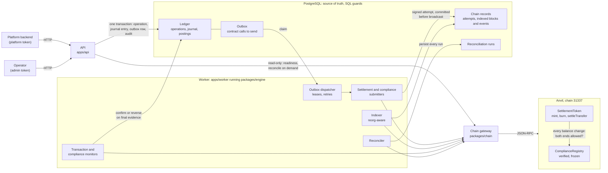
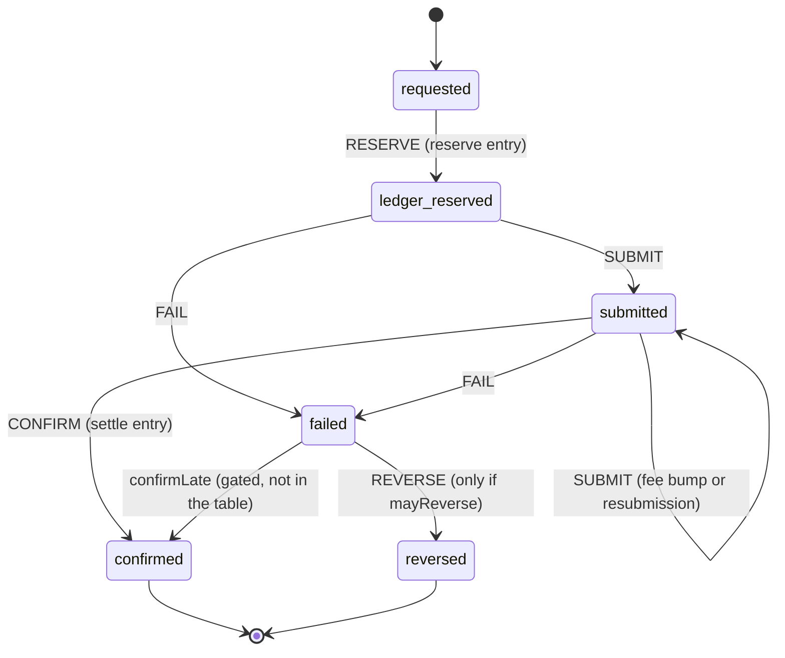
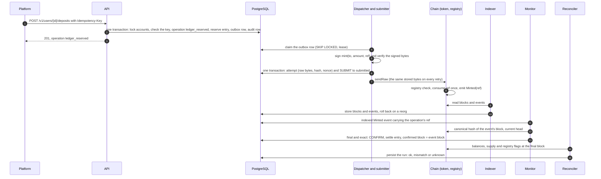

# onchain-settlement-bridge

[](https://github.com/TTB8/onchain-settlement-bridge/actions/workflows/ci.yml)
[](LICENSE)

A reference implementation of the seam between a business ledger and a blockchain. Users hold
balances in a double-entry ledger in PostgreSQL; a permissioned ERC-20 token on chain mirrors those
balances and enforces compliance. Deposits mint, withdrawals burn, transfers settle on chain, and a
reconciler proves at every run that the two sides agree. It is written in TypeScript (NestJS,
Prisma, viem) and Solidity (Foundry), runs locally against Anvil in four commands, and is tested
down to reorgs, dropped transactions and node outages.

**The problem in one line: chain state and ledger state must never disagree, and when they might,
the system must fail safe.**

- [Why this is hard / what it proves](#why-this-is-hard--what-it-proves)
- [Architecture](#architecture)
- [Design decisions and why](#design-decisions-and-why)
- [Safety properties and how they are tested](#safety-properties-and-how-they-are-tested)
- [What the reviews found](#what-the-reviews-found)
- [Out of scope / known limits](#out-of-scope--known-limits)
- [Quickstart](#quickstart)
- [Repository map](#repository-map)
- [Testing](#testing)
- [CI](#ci)
- [Roadmap](#roadmap)

## Why this is hard / what it proves

A database transaction cannot span a blockchain. Between "the ledger reserved the money" and "the
chain moved the token" there is a network, a mempool, a fee market, reorgs and nodes that answer
with timeouts. Every shortcut ends in one of two incidents: money moved on chain with no record in
the books, or the books refunding a user for a payment that in fact went through.

This repository shows how to integrate a chain into a real business without breaking the books:

- **Every money move is a ledger operation first.** The chain is called only through a
  transactional outbox, never inside a database transaction.
- **Retries cannot pay twice.** Each on-chain action carries a single-use reference that the
  contract itself refuses to accept a second time.
- **Nothing counts until it is final.** Settlement, nonce use and reversal are decided on evidence
  that is `depth` blocks deep and on the node's canonical block hashes, never on the head.
- **"I don't know" is a state.** A timeout is not a failure, and a missing event is not proof that
  nothing happened. When the evidence is incomplete the system waits, keeps the funds held and
  raises an alarm.
- **Compliance is enforced by the contract**, so a leaked API credential or a direct chain call
  cannot move a frozen balance.
- **The database refuses bad states on its own**: unbalanced entries, overdrafts, illegal status
  edges and history rewrites are rejected by SQL guards, even if the application has a bug.
- **A reconciler checks the two sides at a final block** and reports any mint, transfer or
  compliance change the ledger did not authorise. `pnpm demo --rogue` shows it catching one.

## Architecture

The API holds no signing key: it writes the ledger and the outbox in one transaction and returns.
The worker runs the engine: it sends what the outbox holds, indexes the chain, decides each
operation on final evidence and reconciles.



### The operation lifecycle

This is the exact table in [`packages/domain/src/operation.ts`](packages/domain/src/operation.ts)
(`OPERATION_TRANSITIONS`). Every other edge throws, and the database refuses it again. The API's
request creates an operation directly in `ledger_reserved`, in the same transaction as its reserve
entry. `failed` is not terminal: a transaction the engine gave up on can still land, and then the
operation settles late, but only through `confirmLate`, which demands a final, canonical event
that matches the operation exactly.



Funds stay held while an operation is `failed`. Only REVERSE releases them, and only CONFIRM or a
gated late confirmation settles them; `confirmed` and `reversed` are terminal.

### A deposit, end to end

The real flow, as the [engine README](packages/engine/README.md) describes it step by step.



## Design decisions and why

Each decision has a short record in [docs/decisions/](docs/decisions/README.md) that names the
alternative and what the choice costs.

**The database is the source of truth.** A chain cannot reserve funds while a compliance check
runs, cannot reverse a failed operation and cannot hold the fiat side of a deposit. So balances
live in a double-entry ledger in Postgres, derived from postings and never stored, and the token is
a mirror that enforces compliance. A chain failure becomes a ledger state (`failed`, then
`reversed`), not a lost balance. [ADR 0001](docs/decisions/0001-database-is-authoritative.md)

**A transactional outbox.** Writing the ledger and then calling the chain has two bad endings: money
reserved and nothing sent, or a payment with no record. The API writes the operation, its reserve
entry and an outbox row in one transaction; the worker sends from the outbox, with no database
transaction or row lock held across a network call. Delivery is at least once, made safe by the
next decision. [ADR 0002](docs/decisions/0002-transactional-outbox.md)

**Single-use on-chain references as idempotency keys.** Every operation's UUID becomes a 32-byte
reference that the contract records and refuses to consume twice (`ReferenceAlreadyUsed`), and every
state-changing call emits an event carrying it. A retry, a resubmission or a replacement racing the
original cannot mint or move twice. Because a used reference only proves it was used, not what for,
the engine compares the event's type, parties and amount before it believes it.
[ADR 0003](docs/decisions/0003-single-use-references.md)

**Settle on final evidence only.** A transaction with fewer than `depth` confirmations can still
disappear in a reorg. Receipts, settling events, nonce use and the contract's reference flag count
only at block `head - depth + 1`, with block hashes taken from the node at the time of the
decision; before that the answer is `wait`. Reconciliation runs at that final block too.
[ADR 0006](docs/decisions/0006-settle-on-final-evidence.md)

**Never reverse on absence of evidence.** Reversing releases held funds; if the chain settles the
same operation later, the user is paid twice. `mayReverse` requires every attempt's nonce to be
final, no indexed event for the reference, and the contract's own `referenceUsed` flag false at a
final block. A reference that is used with no event in our index means the index is incomplete, so
it escalates to a person instead. Stuck funds are possible; double payment is not.
[ADR 0007](docs/decisions/0007-never-reverse-on-absence-of-evidence.md)

**Compliance enforced in the contract, not only in the API.** If the allowlist lived only in the
API, a leaked key or a direct call would bypass it. The token checks the registry on every balance
change through one internal choke point, so a frozen or unverified address cannot send, receive or
be burned from by any role. Compliance changes travel through the same outbox as money.
[ADR 0008](docs/decisions/0008-compliance-in-the-contract.md)

**`bigint` amounts and UTC.** Floating point cannot hold token amounts exactly. Amounts are integers
in the smallest unit (6 decimals) in code, `bigint` in Postgres and decimal strings in JSON; the
domain caps a single amount at the column's range and refuses an overflow instead of wrapping.
Every timestamp is UTC and time is always passed into the domain as an argument.
[ADR 0010](docs/decisions/0010-amounts-and-time.md)

**An unknown outcome is not a failure.** A timeout or an unfamiliar node error may mean the node
accepted the transaction. Only an allowlist of answers counts as a rejection, and even that only for
the node that answered; everything else is "unknown, check by hash before sending again". Every
signed transaction is kept until its nonce is final, so a node outage can neither cancel nor
double-pay anything. [ADR 0009](docs/decisions/0009-unknown-outcomes-fail-safe.md)

**Deployment binding.** References live inside one contract, so following a redeployed token would
silently empty the duplicate guard for every operation in flight. Each operation and attempt
records its chain id and token, the database refuses to deactivate a deployment with work in
flight, and a deployment record is written only after a script verifies it on chain and never
silently replaced. [ADR 0011](docs/decisions/0011-deployment-binding.md)

The other records: the rules live in a pure domain package
([0004](docs/decisions/0004-pure-domain-package.md)), chain access goes through one interface with
a faithful fake and a parity test ([0005](docs/decisions/0005-chain-gateway-fake-and-parity.md)),
and the engine's eighteen obligations ([0012](docs/decisions/0012-engine-obligations.md)).

## Safety properties and how they are tested

Each property is enforced in at least one place that does not depend on the others being right.
The test names are quoted from the suites; the full tables are in the
[engine](packages/engine/README.md#tests) and [db](packages/db/README.md#the-guards-and-the-tests-that-attack-them)
READMEs.

| Property                                       | Where it is enforced                                                                   | Evidence                                                                                                                          |
| ---------------------------------------------- | -------------------------------------------------------------------------------------- | --------------------------------------------------------------------------------------------------------------------------------- |
| Every journal entry balances                   | Domain `assertBalanced`; db guard 1 (deferred trigger at COMMIT)                        | db `ledger-balance`: "refuses an unbalanced entry at COMMIT"; domain seeded property test of conservation                          |
| No user balance goes negative, even under races | Engine reads the balance under a row lock (obligation 18); db guard 2 at COMMIT       | engine: "N parallel withdrawals ...", "withdrawals and transfers racing ..."; db `overdraft`: four concurrency tests                |
| History is append-only                         | db guard 3 (UPDATE, DELETE, TRUNCATE refused)                                           | db `append-only`: raw SQL and Prisma attempts on every table                                                                       |
| Only legal status edges                        | Domain `OPERATION_TRANSITIONS`; db guard 4; version literal against lost updates        | db `operation`: all 36 from/to pairs; engine `move-operation`: "illegal edges are refused before the database is touched", "stale reads" |
| One operation per idempotency key              | Engine lookup under the lock; unique `(user_id, idempotency_key)`                       | engine idempotency (7 tests, concurrent copies included); API `operations.http` "idempotency" (4); e2e replay gives one operation and one transaction |
| A retry can never pay twice                    | Contract single-use reference; attempts committed before broadcast, same bytes resent   | Foundry `invariant_everyReferenceSettledAtMostOnce`, `testFuzz_aReferenceWorksExactlyOnce`; engine scenarios "an outbox row delivered twice ...", "a crash between the attempt commit and the broadcast ..." |
| Settle only on final, canonical, exact evidence | Domain `lateConfirmation` / `resolveRevert`; engine obligations 9 and 12             | engine scenarios "a stale event from an orphaned block ...", "a reorg removing a not-yet-final transaction ...", "reference_conflict ..." |
| Never release funds on absence of evidence     | Domain `mayReverse`; engine gathers the evidence in the same pass (obligation 7)         | engine scenarios "each piece of reversal evidence blocks on its own" (2), "duplicate_reference ..."                               |
| Unknown is never treated as failure            | Gateway allowlist of rejections; dispatcher retries unknown outcomes                     | engine scenarios "submit outcome unknown ...", "another node accepted what ours rejected ..."; e2e: a stopped node gives `unknown`, never ok |
| Compliance cannot be bypassed on chain         | `SettlementToken._update` checks the registry on every balance change                    | Foundry `invariant_aRestrictedBalanceNeverMoves`, `testFuzz_aFrozenBalanceCannotBeMovedByAnyone`; e2e: a frozen sender's transfer reverts on chain and ends `reversed` |
| Operations stay bound to one deployment        | Engine binding checks (obligation 17); db guards 6a, 6b and 7                            | engine "after a redeploy ...", "request first: the deactivation waits ..."; db "refuses deactivating a deployment with a non-final operation ..." |
| One nonce, one outbox row                      | Signer-state lock in the engine; db guard 8 (advisory lock, READ COMMITTED only)          | db `attempt-nonce`: "two concurrent ... transactions ...: at most one commits"                                                     |
| Anything the ledger did not authorise is reported | Reconciler at the final block, every run persisted                                    | engine `reconciler`: rogue mint, rogue holder transfer, rogue registry freeze; reconciler on Anvil; `pnpm demo --rogue`            |

**Mutation evidence.** Tests were also checked by breaking the code on purpose. Two mutants
survived at first and led to stronger tests, recorded in [docs/engineering-lessons.md](docs/engineering-lessons.md):
a transfer matched on sender and receiver while ignoring the amount (it survived the domain tests,
because the amount tests changed both events together), and a removed stage check that a second
guard hid (so each db test now asserts the specific guard's error tag).

## What the reviews found

The code went through several rounds of independent AI-assisted audit-methodology reviews, one
package at a time: the domain rules (two rounds), the engine's outbox and ledger writes, its
sending and monitoring (two rounds), compliance and reconciliation, the deploy scripts, and the API
and worker. This is not a human audit. The reviews found real bugs, and each fix landed with a
test:

- **A double-payment path.** The first `mayReverse` would release held funds after a
  `ReferenceAlreadyUsed` revert with no event in the index. On the token only a successful
  settlement consumes a reference, so that case means the money already moved. Fixed by requiring
  the contract's own reference flag at a final block and escalating instead
  ([ADR 0007](docs/decisions/0007-never-reverse-on-absence-of-evidence.md)).
- **A phantom settlement.** Reconciliation skipped the missing-event check for an operation whose
  recorded confirmation block lay in the future, so a forged block number could make a run report
  clean for a settlement the chain never made. Fixed by a required final block: such input is now
  refused, and the settling event must sit in the recorded block.
- **Compliance applied in the wrong order.** Expected flags were derived from database order; a late
  change could hide a newer decision. Fixed by deriving them from the latest applied decision by a
  database-assigned sequence and the chain's own order.
- **Dropped transactions, nonces and leases.** A dropped attempt with fees below the node's price
  would only be dropped again, and a give-up could fail an operation while its nonce was not
  final; a timed-out handler could be released while still running, so two handlers could hold one
  row. Fixed with same-nonce replacements at current fees, give-ups only on a final nonce (a
  `nonce_stuck` alarm otherwise), per-row lease fencing, and a database guard that gives each
  signer nonce to one outbox row.
- **API hardening.** Placeholder tokens refused off a local chain, OpenAPI off by default outside
  local, an unreachable database answers 503 instead of 500, and a deposit is documented as a mint
  authority.

The engine README keeps the per-round lists
([review round 1](packages/engine/README.md#review-fixes-round-1), [round 2](packages/engine/README.md#review-round-2)).

## Out of scope / known limits

This is a reference implementation, not a product. These limits are deliberate and documented
where they live:

- **A stuck nonce needs a cancel transaction.** A transaction dropped everywhere keeps its nonce
  reserved; later transactions of that signer queue behind it and the operation cannot be reversed.
  The engine raises `nonce_stuck` and the funds stay held, but the gateway does not offer the
  zero-value self-send that would free the nonce ([engine README](packages/engine/README.md#known-limit-a-dead-nonce-blocks-the-signer-accepted-documented)).
- **No forced burn or transfer, no enforcement or recovery role.** A frozen balance cannot be acted
  on by any role ([ADR 0008](docs/decisions/0008-compliance-in-the-contract.md)).
- **No mint cap and a single-step admin.** A compromised minter can mint without bound until the
  reconciler flags it; production would add a cap and a two-step, delayed admin.
- **Holder-signed transfers are off by default** behind an admin switch. When switched on they are
  compliance-checked, and the reconciler sees them as movements the ledger did not authorise.
- **The platform token is a mint authority.** A deposit is the platform's assertion that fiat
  arrived; the ledger and the chain both record an unbacked deposit, so it reconciles cleanly. Fiat
  evidence, a mint cap per period and proof of reserve are out of scope
  ([API trust assumptions](apps/api/README.md#trust-assumptions)).
- **Ledger balances are per user, not per deployment.** A reconciliation run is `unknown` when a user
  also has operations on another deployment.
- **Historical reads are pinned by block number, not block hash.** The gateway's `readBalance`,
  `readTotalSupply` and `readCompliance` take a block number. The reconciler first checks that the
  node's hash at the final block equals the indexed one, but a reorg deeper than the confirmation
  depth is outside the guarantee (the indexer stops for a person when it sees one beyond its window).
- **Alarms are log lines only.** No pager, webhook or table: ship stdout to a log pipeline and alert
  on `"msg":"alarm"`.
- **No rate limiting and one shared operator identity.** Two static bearer tokens; production puts an
  identity provider, per-operator identities and edge rate limiting in front.
- **The application's database role must not own the tables.** The owner can disable the guard
  triggers. This is an operator obligation, not enforced by the app.
- **No replay protection per redeploy.** References are per contract; a redeploy is a migration
  procedure (drain, then switch), and the deployment binding refuses to switch while work is in
  flight ([ADR 0011](docs/decisions/0011-deployment-binding.md)).
- **Admin events are not reconciled.** Role grants, pause and the holder switch are not compared with
  any expectation; alert on them ([ADR 0008](docs/decisions/0008-compliance-in-the-contract.md)).
  The promotion script checks the role holders once, at deploy time.
- **Evidence passed to the engine's status moves is self-attested** at that internal API; the
  engine's own components are the only callers.

## Quickstart

Everything is local and DEV ONLY: the only keys are Anvil's public development keys, refused by
both apps on any real chain. You need Docker, Node 20+ with pnpm, Foundry `v1.5.1`, `bash` and
`python3`, and the Solidity libraries (`git submodule update --init --recursive`). The full guide,
with what each step does, a real transcript and troubleshooting, is
[docs/local-development.md](docs/local-development.md).

```bash
docker compose up -d          # Postgres on localhost:5434, Anvil (chain 31337) on 127.0.0.1:8545
pnpm install
pnpm setup:local              # migrate, deploy, promote, register, write .env
pnpm dev                      # API + worker, in this terminal
pnpm demo                     # in a second terminal
```

Then open Swagger at **http://127.0.0.1:3000/docs**. The raw document is at `/docs/openapi.json`.
The demo creates two users, runs a deposit, a transfer and a withdrawal through the public API,
prints ledger and on-chain balances side by side, and ends with `CLEAN: 0 mismatches`.
`pnpm demo --rogue` then mints outside the bridge and shows the reconciler catching it.

## Repository map

```text
.
├── contracts/            Foundry: SettlementToken, ComplianceRegistry, deploy and promotion scripts, tests
├── packages/
│   ├── domain/           The bridge rules as pure functions: ledger, state machine, finality, reconciliation
│   ├── db/               PostgreSQL schema (Prisma) and the SQL guards that make the ledger rules physical
│   ├── chain/            ChainGateway: the viem implementation, an in-memory fake, a parity test on Anvil
│   └── engine/           Outbox dispatcher, submitters, monitors, indexer, reconciler; framework-free
├── apps/
│   ├── api/              NestJS HTTP API: users, money operations, balances, compliance, reconciliation
│   └── worker/           NestJS standalone process that runs the engine loop and holds the signer keys
├── e2e/                  End-to-end suite on a real chain, plus unit tests of the local scripts
├── scripts/              setup:local, demo, dev runner, coverage summary
├── docs/                 Local development guide and design decision records
└── docker-compose.yml    Postgres 16 and Anvil for local development
```

Package documentation: [contracts](contracts/README.md), [domain](packages/domain/README.md),
[db](packages/db/README.md), [chain](packages/chain/README.md),
[engine](packages/engine/README.md), [api](apps/api/README.md), [worker](apps/worker/README.md),
[decisions](docs/decisions/README.md).

## Testing

The database suites run on a real PostgreSQL 16 (the compose one on `localhost:5434`), each test
file in its own fresh database that is dropped afterwards, with every migration and SQL guard
live. The chain suites start their own Anvil on a free port. Neither touches your dev database.

| Suite                      | Command                                   | What it proves                                                                                  | Tests |
| -------------------------- | ----------------------------------------- | ----------------------------------------------------------------------------------------------- | ----: |
| Contracts                  | `pnpm contracts:test`                     | Unit, fuzz (1000 runs) and invariant (256 runs x 64 calls) tests of both contracts and the deploy script | 145 |
| Domain                     | `pnpm --filter @bridge/domain test`       | Every rule as a table of cases, plus a seeded conservation property test                        | 364 |
| Chain                      | `pnpm --filter @bridge/chain test`        | Gateway behaviour, error mapping and URL redaction; the fake and Anvil agree (parity)           | 223 |
| Database                   | `pnpm --filter @bridge/db test`           | Each SQL guard attacked directly, asserting its own error tag                                   | 212 |
| Engine                     | `pnpm --filter @bridge/engine test`       | The 18 obligations: crashes, races, reorgs, drops, unknown outcomes, reconciliation; and on Anvil | 401 |
| API                        | `pnpm --filter @bridge/api test`          | Routes, idempotency, amounts, the 401/403 matrix, problem+json without leaks, startup refusals  | 155 |
| Worker                     | `pnpm --filter @bridge/worker test`       | Startup refusals, fatal alarms, the real engine loop, clean and bounded shutdown                | 32 |
| End to end                 | `pnpm test:e2e`                           | `setup:local` and the demo on a real chain; ledger equals chain at every step; rogue mint caught | 64 |

`pnpm test` runs every package's suite, the end-to-end suite included. `pnpm test:cov` does the same
with coverage thresholds, and `node scripts/coverage-summary.mjs` prints this table from its output:

| Package                                         | Statements | Branches | Functions |   Lines |
| ----------------------------------------------- | ---------: | -------: | --------: | ------: |
| domain (pure bridge rules)                      |       100% |   99.74% |      100% |    100% |
| chain (gateway, fake and viem)                  |     98.79% |   95.91% |      100% |  99.15% |
| db (TypeScript helpers; the SQL guards are tested by attack, above) | 100% | 100% | 100% | 100% |
| engine (outbox, submitter, indexer, reconciler) |     95.52% |   90.39% |    99.16% |  97.41% |
| api                                             |     99.07% |   90.42% |     98.7% |   99.7% |
| worker                                          |       100% |   90.69% |      100% |    100% |

Contracts (`pnpm contracts:coverage`): 100% of lines, statements, branches and functions in both
`ComplianceRegistry.sol` and `SettlementToken.sol`.

In total: 145 Foundry tests and 1,451 Jest tests (1,387 package tests and 64 end-to-end), all
passing at the commit this README was written against. Numbers move with the code; CI prints the
current coverage table in every run's summary.

Static checks: `pnpm lint && pnpm format:check && pnpm typecheck`.

## CI

[`.github/workflows/ci.yml`](.github/workflows/ci.yml) runs on every pull request and every push to
`main`, with all third-party actions pinned to a commit:

- **TypeScript** on Node 20 and 22, with a Postgres 16 service and Foundry: lint, format check,
  typecheck, contract build, a check that the committed ABIs equal the Foundry build, every test suite
  with coverage (each package has its own thresholds), and the coverage table in the run summary.
- **Contracts**: `forge fmt --check`, build with contract sizes, `forge test`, the deployment
  promotion script against its own Anvil, the gas snapshot, and coverage.

Dependabot proposes npm and GitHub Actions updates weekly.

## Roadmap

Possible next steps, roughly in the order a production deployment would need them:

- a cancel transaction for a dead nonce, so a stuck signer can be released by an operator;
- an alarm transport (webhook or table) and an operator view of open escalations;
- per-deployment ledger accounts, and reads pinned by block hash;
- a mint cap, a fiat receipt reference per deposit, and a proof-of-reserve gate on minting;
- an enforcement role and a two-step, delayed admin on the contracts;
- a public testnet deployment.

## License

[MIT](LICENSE). Contributions are welcome: see [CONTRIBUTING.md](CONTRIBUTING.md),
[SECURITY.md](SECURITY.md) and the [Code of Conduct](CODE_OF_CONDUCT.md).

Built by TTB8, available for consulting.
